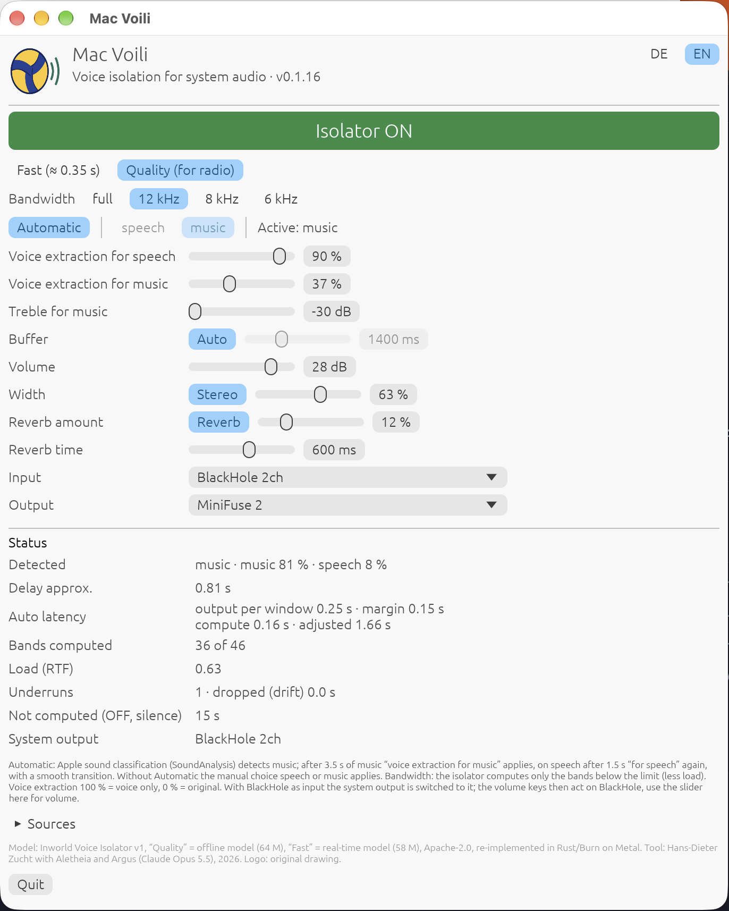
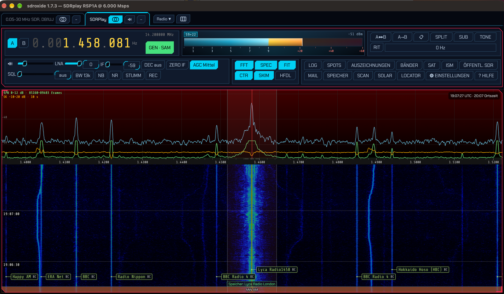

# Mac Voili – Anleitung

**Stimmisolation für verrauschte Tonquellen und SDR-Funkanwendungen**

Auf Basis des [Inworld Voice Isolator v1](https://github.com/inworld-ai/voice-isolator) von [Inworld AI](https://inworld.ai).

**Download:** [neueste Release](https://github.com/HDZucht/mac-voili/releases/latest) (DMG) · **English:** [README.md](README.md)

## Wozu das Programm gut ist

Mac Voili holt Stimmen aus verrauschtem Ton heraus, live und während du zuhörst. Das Programm hängt sich in den Systemton des Mac und lässt jeden Ton durch ein neuronales Netz laufen, das nur die menschliche Stimme behält: den Webbrowser mit KiwiSDR oder WebSDR, SDR-Programme wie SDR Oxide oder SDR++, Streams und Aufnahmen. Rauschen, Prasseln, Pfeifen, Träger, Interferenzen und Nachbarsender werden weitgehend entfernt.

Gedacht ist es für Funk, der sonst kaum anhörbar ist:

- **Kurzwellen-Rundfunk (AM)** bei Fading, Gewitterprasseln und Störungen durch Nachbarkanäle
- **SSB-Funk** im Amateurfunk, Flugfunk und Seefunk auf Kurzwelle, oft am Rand der Hörbarkeit
- **Ferne Stationen über Web-SDR-Empfänger** (KiwiSDR, WebSDR, UberSDR)
- **Verrauschte Aufnahmen und Streams** jeder Art

Das Netz ist der [Inworld Voice Isolator v1](https://github.com/inworld-ai/voice-isolator) von [Inworld AI](https://inworld.ai), quelloffen unter Apache-2.0 (Gewichte auf [Hugging Face](https://huggingface.co/inworld/voice-isolator), [Vorstellung](https://inworld.ai/blog/introducing-voice-isolator)). Mac Voili hat es in Rust für die Grafikeinheit des Mac nachgebaut, der Ton verlässt den Rechner nicht.

## Einsatzbereich, z. B. SDR-Funk

Mittelwelle AM am Abend: Lyca Radio 1458 kHz (London) in [SDR Oxide](https://github.com/dividebysandwich/sdroxide) mit einem SDRplay RSP1A, Synchron-AM (SAM), umgeben von BBC Radio 4, Radio Nippon und weiteren Sendern auf den Nachbarkanälen. Der Ton des Empfängers geht über BlackHole in Mac Voili. Die Einstellungen im Mac-Voili-Fenster oben sind die für diesen Sender: Qualität, Bandbreite 12 kHz, Automatisch, Sprachextraktion 90 % bei Sprache und 37 % bei Musik, Höhen bei Musik −30 dB, Breite 63 %, Hall 12 % bei 600 ms.

Das geht mit jedem Programm, das auf dem Mac Ton ausgibt: KiwiSDR, WebSDR und UberSDR im Browser, SDR++, SDRconnect, Aufnahmen und Streams.

## Der wichtigste Kniff: Sprache und Musik verschieden einstellen

Der Isolator kennt nur Stimme und alles andere. Bei Sprache ist das genau richtig: Das Rauschen verschwindet, die Stimme bleibt. Bei Musik nimmt der Isolator dagegen die Instrumente mit weg, weil sie keine Stimme sind. Übrig bleiben ein hohler Gesang und Bruchstücke.

Rundfunksender wechseln laufend zwischen Nachrichten, Moderation und Musik. Mac Voili erkennt deshalb mit Apples Klangerkennung, was gerade läuft, und schaltet zwischen **zwei Stärken** um:

| Regler | Empfehlung | Wirkung |
|---|---|---|
| **Sprachextraktion bei Sprache** | **95–100 %** | Volle Rauschbefreiung, nur die Stimme bleibt |
| **Sprachextraktion bei Musik** | **0–20 %** | Musik bleibt vollständig, nur ein wenig Isolator |
| **Höhen bei Musik** | **−6 bis −18 dB** | Senkt das Rauschen bei Musik ab, ohne die Instrumente zu zerstören |

So wird ein stark gestörter Sender durchgehend anhörbar: Bei Sprache filtert der Isolator kräftig, bei Musik übernimmt der Höhenregler die Rauschminderung. Ist **Automatisch** eingeschaltet, wechselt Mac Voili nach 3,5 s Musik zur Musik-Einstellung und nach 1,5 s Sprache wieder zurück, mit weichem Übergang. Die Anzeige „Gilt:“ zeigt, welche Einstellung gerade wirkt.

## Empfohlene Einstellungen

### Extrem gestörter SSB-Funk (Amateurfunk, Flugfunk, Seefunk)

- **Qualität** wählen. Das Offline-Modell sieht ein Stück Ton vor und nach jeder Silbe und holt deshalb mehr aus schwachen Signalen.
- **Automatisch aus, Sprache von Hand.** Auf SSB läuft keine Musik, und starkes Rauschen kann die Klangerkennung täuschen.
- **Sprachextraktion bei Sprache 100 %.**
- **Bandbreite 6 oder 8 kHz.** SSB belegt etwa 3 kHz, darüber liegt nur Rauschen, und das Netz rechnet weniger.
- **Lautstärke +10 bis +20 dB.** Die isolierte Stimme ist leiser als das verrauschte Original, ein weicher Begrenzer fängt Spitzen ab.

### Kurzwellen-Rundfunk mit Nachrichten und Musik

- **Qualität**, **Automatisch an**.
- **Sprachextraktion bei Sprache 95–100 %**, **bei Musik 0–20 %**.
- **Höhen bei Musik −6 dB** bei leichtem Rauschen, **−12 bis −18 dB** bei starkem.
- **Bandbreite 8 oder 12 kHz.**

### Gute Signale, Abstimmen, Gespräche

- **Schnell** (Echtzeitmodell, Verzögerung etwa 0,35 s). Zum Abstimmen auf eine Station und für Funkverbindungen, bei denen die Verzögerung stört.
- Danach für schwache Phasen auf **Qualität** wechseln.

### Angenehmer über lange Zeit

Die isolierte Funkstimme ist mono, trocken und schmalbandig, das ermüdet auf Dauer. Zwei Regler machen sie räumlicher:

- **Breite (Stereo) etwa 30 %:** Die Stimme verteilt sich über das Stereobild, je Frequenz in eine eigene Richtung. In Mono bleibt sie unverändert.
- **Hall 15–25 %, Nachhallzeit 300–500 ms:** Ein kleiner Raum um die Stimme. Längere Zeiten bis 1000 ms klingen nach Saal.

## Hinweise

- **Klingt die Stimme abgehackt oder metallisch,** die Sprachextraktion auf 85–90 % senken. Ein kleiner Rest Original macht sie natürlicher.
- **Verzögerung:** „Qualität“ liegt je nach Mac bei etwa 1–2 s, die Auto-Latenz wählt selbst die kürzeste Einstellung ohne Aussetzer. „Schnell“ liegt bei etwa 0,35 s.
- **Voili Server** (Webversion im Browser) hat dieselben Klangregler. Dort heißt der Regler „Mix“ und zählt den Anteil des Originals: Mix 5 % entspricht Sprachextraktion 95 %. Der Musik-Umschalter entspricht „Automatisch“.
- **Einrichten:** DMG öffnen, App nach „Programme“ ziehen, erster Start per Rechtsklick → „Öffnen“; für den Systemton BlackHole 2ch installieren (`brew install blackhole-2ch`) und in Mac Voili als Eingang wählen.

---

© 2026 Hans-Dieter Zucht · Apache-2.0
